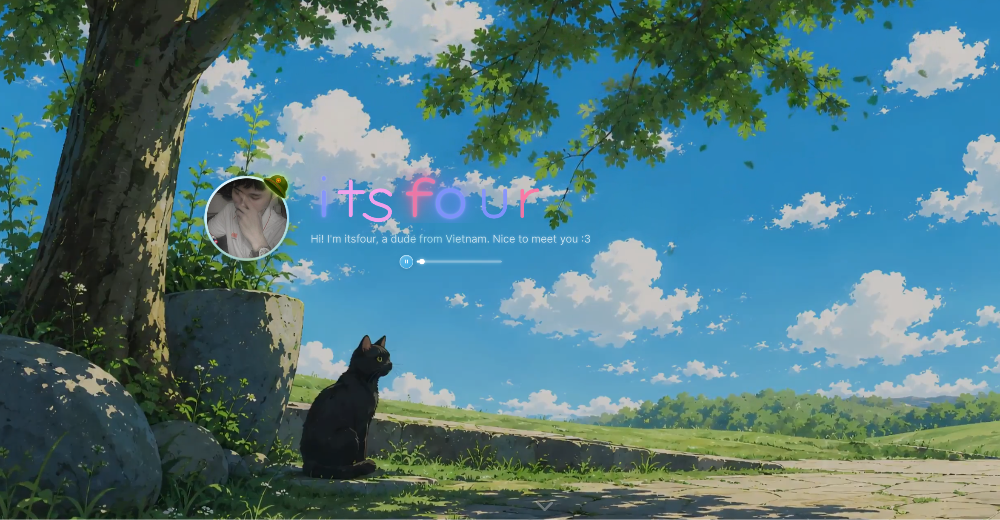

<div align="center">
  
  <br>
    

  <br>
  <p>
    
    <a href="LICENSE"></a>
  </p>

  <p>
    <a href="https://github.com/itsfour"></a>
    
  </p>

[](https://thientu.netlify.app/)

  <p>A personal corner on the web, built to share projects, music, and a little bit of everyday life.</p>


---

## About
</div>
<div align="center">
  

</div>

The site combines a lightweight, framework-free frontend with Netlify Functions for server-side integrations. It brings together a GitHub portfolio, Discord presence, a music player, video backgrounds, and a persistent visitor counter.

## Features

| Area | What it provides |
| :--- | :--- |
| GitHub portfolio | Public repositories, stars, forks, contribution totals, code changes, repository traffic, contributed repositories, and language breakdown. |
| Discord presence | User profile, online status, and current activities through Lanyard. |
| Discord invite | Server name, icon, and approximate member counts. |
| Music player | Playlist generated from supported audio files in `music/`. |
| Video backgrounds | Rotating background clips selected from supported files in `media/`. |
| Visitor counter | Persistent count stored with Netlify Blobs. |
| Responsive interface | Layouts for both desktop and mobile screens. |

## Languages and tools

<p>
  
  
  
  
  
</p>

## Connect

<p>
  <a href="https://discord.com/users/458318691172352012"></a>
  <a href="https://www.facebook.com/itsthientu/"></a>
  <a href="https://www.tiktok.com/@_itsfour"></a>
  <a href="mailto:itsfour.932@gmail.com"></a>
</p>

### Project technology

The frontend uses browser-native JavaScript modules without a framework or bundler. Node.js scripts generate the media manifests, and Netlify Functions handle server-side API requests. Netlify Blobs provides persistent storage for the visitor counter.

## Project structure

```text
.
├── index.html                 # Page markup
├── index.css                  # Site styles
├── index.js                   # Browser interactions and data rendering
├── site-config.mjs            # Shared profile and social configuration
├── netlify.toml               # Build, publish, and functions configuration
├── netlify/
│   └── functions/             # Netlify serverless endpoints
├── scripts/
│   ├── generate-media-manifest.mjs
│   └── netlify-dev.mjs
├── media/                     # Video files and generated videos.json
└── music/                     # Audio files and generated tracks.json
```

## Quick start

### Prerequisites

- Node.js and npm
- Netlify CLI (the development script invokes it through `npx`)
- A GitHub token if you want to use the GitHub profile function locally

### Run locally

```bash
git clone https://github.com/itsfour/site.git
cd site
npm install
npm run dev
```

`npm run dev` regenerates the media manifests and starts Netlify Dev, which serves the static site and runs the Netlify Functions locally. The GitHub widget needs `GITHUB_TOKEN`; configure it as described below. Other site features can be explored without the token, but the GitHub endpoint will return an error.

To regenerate the manifests without starting the development server:

```bash
npm run build
```

The build script scans `media/` and `music/` and writes `media/videos.json` and `music/tracks.json`. Run it after adding or removing supported files.

## Work in Visual Studio Code

No special VS Code extension is required. Install [Visual Studio Code](https://code.visualstudio.com/) and the current [Node.js LTS release](https://nodejs.org/) first; npm is included with Node.js.

### Open and run the project

1. In VS Code, select **File → Open Folder...** and open the cloned `site` repository.
2. Open **Terminal → New Terminal**. The terminal should start in the project root, alongside `package.json`.
3. Confirm Node.js and npm are available:

   ```bash
   node --version
   npm --version
   ```

4. Install dependencies once:

   ```bash
   npm install
   ```

5. If you need GitHub data locally, create `.dev.vars` in the project root and add your token:

   ```env
   GITHUB_TOKEN=your_github_token
   ```

   Keep this file private; it is ignored by Git.

6. Start the development server:

   ```bash
   npm run dev
   ```

7. Open the local URL printed in the terminal. Netlify Dev commonly uses `http://localhost:8888`; use the URL shown in your terminal if it differs.

Leave the terminal running while you work. Save your changes and refresh the browser to see them. Press **Ctrl+C** in the terminal to stop the server.

### Where to make changes

| To change | Edit |
| :--- | :--- |
| Page text, section content, or HTML elements | `index.html` |
| Colors, spacing, layout, and responsive styles | `index.css` |
| Browser interactions and rendering | `index.js` |
| GitHub, Discord, social links, or email | `site-config.mjs` |
| Images and icons | Replace or add files in `img/`, then update their references in `index.html` or `index.css` if needed. |
| Background videos | Add supported video files to `media/`. |
| Music tracks | Add supported audio files to `music/`. |

After adding or removing media, regenerate the manifests from the VS Code terminal:

```bash
npm run build
```

This updates `media/videos.json` and `music/tracks.json`; do not edit those generated files by hand. Refresh the site after the build completes.

## Configuration

### Site profile and social links

Update [`site-config.mjs`](./site-config.mjs) to change the GitHub account, Discord user and invite, social profiles, or email address. The frontend and Netlify Functions read from this shared configuration.

### GitHub token

The `/fetchgithub` function requires a GitHub token to query profile and repository data. The token must also be authorized to access repository traffic data for the repositories where that metric is available.

For local development, create a `.dev.vars` file in the repository root:

```env
GITHUB_TOKEN=your_github_token
```

The development script loads `.dev.vars` before starting Netlify Dev. This file is excluded by Git. Never commit the token or expose it in browser code, logs, or screenshots.

For deployment, add `GITHUB_TOKEN` in the Netlify site's environment variables. Set it for the deploy contexts where the GitHub function is needed, then create a new deployment after adding or changing the value.

## Deployment

[`netlify.toml`](./netlify.toml) defines the deployment settings:

| Setting | Value |
| :--- | :--- |
| Build command | `npm run build` |
| Publish directory | Project root (`.`) |
| Functions directory | `netlify/functions/` |

To deploy with Netlify:

1. Import this repository into Netlify or connect it to the existing site.
2. Keep the base directory at the repository root and use the settings from `netlify.toml`.
3. Add `GITHUB_TOKEN` in the site's environment variables.
4. Deploy the site. Redeploy whenever you update the environment variable.

The GitHub function responds with HTTP `503` if `GITHUB_TOKEN` is not available to the deployed function. Store secrets only in Netlify's environment settings, never in the repository or `netlify.toml`.

## Netlify Functions

| Endpoint | Method | Response |
| :--- | :--- | :--- |
| `/count` | `GET` | Increments the visitor count and returns an SVG image. Uses Netlify Blobs. |
| `/fetchdiscordinvite` | `GET` | Discord server name, icon URL, and approximate online/member counts. |
| `/fetchlanyard` | `GET` | Discord user profile, status, and activities from Lanyard. |
| `/fetchgithub` | `GET` | Public repositories, profile statistics, and language data. Requires `GITHUB_TOKEN`. |

Function responses depend on the availability and permissions of external services. An integration can fail independently of the static site.

## Troubleshooting

| Symptom | Check |
| :--- | :--- |
| GitHub data does not load | Confirm `GITHUB_TOKEN` is set for the active deploy context and redeploy. Check the function logs for GitHub API errors. |
| GitHub traffic displays `-` | Confirm the token can access traffic data for the affected repositories. |
| Playlist or video list is empty | Run `npm run build` and confirm supported files are present in `music/` or `media/`. |
| Discord data does not load | Check the function response and the status of Discord or Lanyard. |
| Visitor counter fails | Check Netlify Function logs and confirm Netlify Blobs is available to the deployed function. |

## License

Copyright © 2026 itsfour. Licensed under the [GNU Affero General Public License v3.0](./LICENSE).
